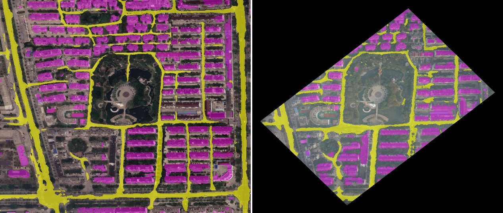
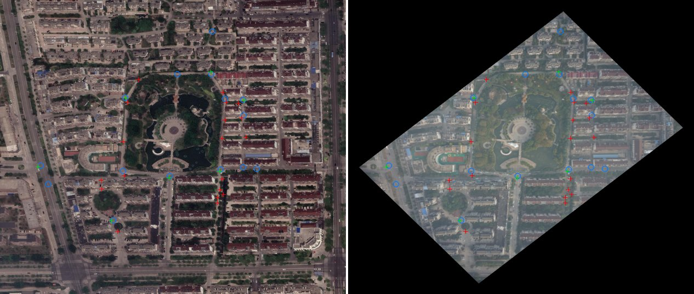

# Milestone 2: landmark repeatability (go/no-go)

Date: 2026-11-02. Flights 03 (Taizhou-1) and 04 (Taizhou-6), every 8th frame.

**Question:** if the same extractor runs on a drone image and on the satellite map under it, do
the points land in the same places? Quad hashing needs all 4 points of a quad to repeat.

**Answer: no, not well enough for intersection-based quad hashing.** Details below.

## Method

1. **Reference alignment (analysis only, `gpsloc/align.py`).** Start from the CSV position,
   heading (`Phi1`) and height, then refine with SIFT matches restricted to an 80 m
   neighborhood and a RANSAC affine fit. Aligns 64-67 of 96 sampled frames per flight (about
   70%). Frames that fail are probably harder ones, so the numbers below are, if anything,
   optimistic.
2. Resample drone image and map patch to 1.0 m/px, run the same extractor on both, keep points
   at least 15 m from the image border.
3. Project drone points onto the map; count drone points with a map point within r meters.
   **Chance** is the rate a random point would get from the map point density alone.
   **All-4-of-a-quad** is rate⁴: the rough share of quads whose 4 points all repeat.

## Results

Drone image footprint at ~470-545 m height: about 480 x 320 m, so **0.12-0.17 km²** of ground
per image (after the 15 m border).

| Extractor | Flight | Points / image (median) | Repeat ≤ 5 m | Chance ≤ 5 m | Repeat ≤ 10 m | All 4 of a quad ≤ 10 m | Time / image |
|---|---|---|---|---|---|---|---|
| corners (Shi-Tomasi) | 03 | 48 | 25% | 3% | 45% | 4.0% | 3 ms |
| corners | 04 | 66 | 33% | 3% | 54% | 8.3% | 4 ms |
| lsd (segment junctions) | 03 | 3 | 15% | 0.3% | 23% | 0.3% | 19 ms |
| lsd | 04 | 7 | 19% | 0.3% | 30% | 0.8% | 25 ms |
| roads (classic mask → skeleton) | 03 | 92 | 21% | 5% | 43% | 3.3% | 18 ms |
| roads | 04 | 120 | 21% | 4% | 43% | 3.4% | 23 ms |
| segroads (learned mask → skeleton) | 03 | 8 | 18% | 0.5% | 35% | 1.5% | 11 s |
| segroads | 04 | 2 | 19% | 0.2% | 29% | 0.8% | 15 s |

`segroads` uses `kishan4444/upernet-swin-openearthmap-road-segmentation` (UperNet + Swin-T,
OpenEarthMap classes) on 20 frames per flight. Time is on the 4-core VPS CPU.

## What the pictures show

- **Alignment is good.** Warped drone images line up with the map at building level.
- **Classic extractors fire on the wrong things.** Satellite images have hard shadows and high
  contrast; drone images are hazy and soft. Corners and "road" pixels land on roof edges and
  shadows that differ between the two.
- **The learned road masks agree well** (road IoU ≈ 0.40 on a checked frame, building IoU ≈ 0.40;
  the network, ring road around the park and the street grid are clearly the same). But
  **intersection points taken from those masks do not**: the drone side sees small alleys the
  satellite side misses (and vice versa), and differences in road width move skeleton nodes by
  7-10 m.
- **Too few intersections per image.** One drone image covers ~0.15 km², which holds only
  2-8 road intersections even in town, and fewer over farmland.

## Decision

Quad hashing on road intersections is a **no-go** in this form: too few points per image and
under 20% repeat within 5 m. Under 1.5% of quads would survive at 10 m.

Generic corners repeat better (25-33% at 5 m, about 10x chance) and are dense, but 4-point
survival is still only 1-8% at a loose 10 m, against a map index of millions of quads. That is
marginal at best.

**What does transfer well is the segmentation itself:** road and building layouts agree between
drone and satellite even though pixels, shadows and haze differ. That suggests matching
**semantic layouts** (road/building masks) instead of points, or using the learned fallback from
the plan (global descriptor retrieval + local feature matching).

## Side findings

- **Camera tilt:** the CSV `lat/lon` is the drone's position; the image center is offset from it
  by tilt. Pitch/roll explain 70-87% of the offset (coefficients ≈ -1 per m of `h·tan(angle)`,
  as geometry predicts), plus a constant ~17 m along the image y axis (camera mount angle or
  timing). Median offset 22 m. **Vision alone cannot get below about 20 m median error against
  the CSV position** without knowing tilt. The harness should also score against the
  tilt-corrected image center.
- **Camera intrinsics:** drone ground resolution ≈ height / 3850 px, i.e. focal length
  ≈ 3850 px for the 3976 px wide images (about 55° horizontal field of view). Needed for altitude
  from scale later.
- **VPS:** OpenCV's bundled OpenBLAS mis-detects the QEMU virtual CPU and crashes with "Illegal
  instruction"; `gpsloc/__init__.py` sets `OPENBLAS_CORETYPE=Haswell` to avoid it.

## Reproduce

```bash
gpsloc repeat --flight 03 --flight 04 --extractor corners --extractor lsd --extractor roads --step 8
gpsloc repeat --flight 03 --flight 04 --extractor segroads --step 8 --limit 20   # ~30 min on CPU
```

## Figures

Learned segmentation, satellite (left) vs drone warped onto the map (right). Yellow = road,
magenta = building:



Intersections from those masks. Blue circles = map points; crosses = drone points, green if a
map point is within 5 m, red if not:


